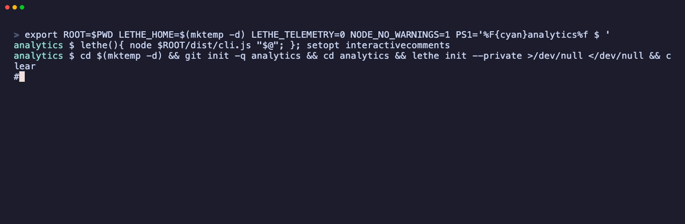

<p align="center">
  <picture>
    <source media="(prefers-color-scheme: dark)" srcset="assets/dark-seahorse.jpeg">
    
  </picture>
</p>

<h1 align="center">lethe</h1>

<p align="center"><b>A memory harness for coding agents that forgets on purpose.</b></p>

<p align="center">
  <a href="https://github.com/alarv/lethe/actions/workflows/ci.yml"></a>
  <a href="https://www.npmjs.com/package/@alarv/lethe"></a>
  <a href="https://nodejs.org"></a>
  <a href="LICENSE"></a>
</p>

<p align="center">
  <a href="#install">install</a> ·
  <a href="#what-it-does">what it does</a> ·
  <a href="docs/brain.md">how memory works</a> ·
  <a href="#contributing">contributing</a>
</p>

---

Your agent solved it on Tuesday. On Thursday, in a new session, it has no idea.

Every memory tool answers that by storing more. lethe answers it by storing **less,
better** — it distils what happened into what is true, and throws the rest away.

<p align="center">
  
</p>

In practice your agent makes these calls itself over MCP; the CLI is the same memory,
for when you want to look.

## Install

Works in any host that speaks MCP.

**Claude Code**

```sh
claude mcp add lethe --scope user -- npx -y @alarv/lethe@latest mcp
```

**opencode** — `~/.config/opencode/opencode.json` for every project, or `opencode.json`
in a repo for just that one:

```json
{
  "mcp": {
    "lethe": {
      "type": "local",
      "command": ["npx", "-y", "@alarv/lethe@latest", "mcp"],
      "enabled": true
    }
  }
}
```

**Cursor · Windsurf · Zed** — anything reading `mcp.json`:

```json
{
  "mcpServers": {
    "lethe": { "command": "npx", "args": ["-y", "@alarv/lethe@latest", "mcp"] }
  }
}
```

**Codex CLI** — `~/.codex/config.toml`:

```toml
[mcp_servers.lethe]
command = "npx"
args = ["-y", "@alarv/lethe@latest", "mcp"]
```

Then confirm it:

```sh
npx @alarv/lethe@latest doctor
```

The `@latest` tag means every new session runs the latest published version. A global
install is the exception — update it with `npm i -g @alarv/lethe@latest`; `doctor` says
when the published version is newer.

Needs Node 22+. On older versions retrieval falls back to a simpler ranker rather than
failing.

## What it does

Three kinds of memory, and **where a memory lives is decided by what it is, not by who
asks**:

| | | |
|---|---|---|
| `episode` | what happened | raw, verbose, never leaves your machine |
| `claim` | what is true | distilled from episodes, shareable |
| `pattern` | how we do things here | promoted once a claim has earned it |

And three things that happen to them:

**Consolidation.** A deferred pass hands your raw episodes to a model, which decides which
of them are about the same underlying problem and writes down what was invariant across
them. Runs off the latency path, never while you wait.

**Forgetting.** Memories decay, are reinforced when used, and are evicted under a capacity
budget — weakest first, cheapest loss first. Capacity is treated as fixed.

**Reconsolidation.** A memory that turns out to be wrong gets corrected, instead of sitting
in the index being confidently wrong forever.

### Memory is text, in your repo

```
.lethe/memory/
  a1b2c3d4-tests-need-containers.md
  e5f6a7b8-async-state-is-a-race.md
```

Readable, diffable, reviewable in a pull request. Claims land in the repo so your team can
review what the agent learned before it becomes shared knowledge; `lethe init` asks once
per project whether to commit them (`--share` / `--private` to skip the question).
Commit only in a private repo — claims can name internal services and the reasoning behind
decisions. Episodes never move: they are a private scratchpad that consolidation
eventually consumes. If you delete lethe tomorrow, you keep the markdown.

### Day to day

```sh
lethe recall "why do the tests fail"   # search
lethe ls                               # everything recorded
lethe status                           # is it working?
lethe log -f                           # watch recalls, notes and compactions live
lethe metrics                          # is it being used, and is it distilling?
lethe learn                            # what has been seeded from this repo
lethe compact --dry-run                # preview consolidation
lethe gc                               # what is in ~/.lethe, and what is dead in it
```

Slow commands report progress on stderr, so stdout stays pipeable (`lethe status | grep`
works). `LETHE_PROGRESS=0` silences it, `LETHE_PROGRESS=1` forces it on.

### How the agent actually calls it

Left alone, an agent mostly doesn't call a memory tool — it has other things on its mind.
So every session starts briefed: the MCP instructions carry a reminder plus the titles of
this project's claims and patterns, best first, in about 1.5 KB. The model sees what exists
and recalls for the detail; raw episodes are never listed. A host that ignores MCP
instructions gets nothing from it. A hook goes further, running `recall` on every message
before the model sees it:

```sh
lethe brief          # exactly what a session started here is told
lethe hook show      # prints the hook config to add to your host
```

opencode gets the same via [`plugins/opencode.js`](plugins/opencode.js).

### Seeding an empty store

An empty store teaches an agent to stop calling `recall`. So `learn` seeds it from what the
repo already says about itself — conventions, commands, gotchas. Every fact must cite a
real file and quote it verbatim, or it is rejected:

```sh
lethe learn      # what has been seeded from this repo, and how strong it still is
```

### It cleans up after itself

`~/.lethe` is the one directory lethe grows where you are not looking:

- **The index prunes itself.** Rows for files that no longer exist go on the next sync.
- **The log is off by default** (`lethe init --debug` turns it on); it rotates at 512 KB
  and keeps one copy. With it off, `metrics` says so rather than reporting zero.
- **Dead project directories are collected** as compaction passes — but only ones holding
  no memories. A directory that still has memories is never removed automatically, however
  dead its path looks. `lethe gc` names those; `lethe gc --dead` removes them once you
  have looked.

## Why a seahorse

Named for the river of forgetting. The seahorse is the hippocampus — *hippos*, horse;
*kampos*, sea monster — which is what early anatomists thought the structure looked like,
and where episodic memory is written before it is either consolidated or lost.

The brain doesn't have one memory system, it has several with different physics, and the
reason is a constraint we share: anything that learns fast enough to record a one-off
event cannot also extract stable general structure without overwriting itself. So the
brain runs a fast sparse episodic buffer alongside a slow dense semantic store, and moves
memory between them during sleep by replaying it. lethe borrows that architecture on
purpose, rather than as a metaphor:

| brain | lethe |
|---|---|
| hippocampus — fast episodic buffer, small, overwritten | `episode` store, hot, bounded |
| neocortex — slow semantic store, large, general | `claim` store, curated |
| sharp-wave ripple replay during rest | consolidation, off the latency path |
| synaptic downscaling during sleep | global decay, reinforcement on access |
| pattern completion — a partial cue reinstates the whole | a query in the old wording still finds the new claim |

Forgetting is the part people find surprising, and it's the whole point. A system that
retained every episode in full detail could never form the concept "dog" — it would have
a million unrelated animal encounters. **Forgetting the incidental is the same operation
as extracting the general rule.**

[`docs/brain.md`](docs/brain.md) has the full account, with citations and an honest
section on where we break from biology.

## Evaluations

[`docs/evals.md`](docs/evals.md) — public, and it reports where lethe loses.

The claim under test: an agent with distilled memory reaches a correct answer in fewer
turns and fewer tokens than one with raw session logs. If distillation can't beat raw
logs, the project should stop.

## Design

- [`docs/brain.md`](docs/brain.md) — how memory actually works: complementary learning
  systems, ripple consolidation, synaptic downscaling, reconsolidation.
- [`docs/architecture.md`](docs/architecture.md) — the three stores, why text is the
  source of truth, how retrieval is layered, salience.
- [`docs/compact.md`](docs/compact.md) — the consolidation pass, when it runs, and who
  provides the model.
- [`docs/evals.md`](docs/evals.md) — what we measure and why.
- [`docs/api-design.md`](docs/api-design.md) — the rules the tool surface is held to.
- [`CHANGELOG.md`](CHANGELOG.md) — what changed, and which failure it fixed.

## Contributing

Issues and pull requests welcome, particularly:

- **Host integrations.** If lethe doesn't work cleanly in your editor or agent, that's a
  bug worth reporting.
- **Eval tasks.** The eval needs real pairs: something discovered in one session that a
  later session needs. Invented ones encode our assumptions about what memory is for,
  which is exactly what's being tested.
- **Retrieval and consolidation quality.** Both are measured, so an improvement can be
  demonstrated rather than argued.

```sh
git clone https://github.com/alarv/lethe.git && cd lethe
npm install && npm test
```

Commit messages here are prose explaining the *why* and the failure being fixed, rather
than a conventional-commit prefix. [`AGENTS.md`](AGENTS.md) has the conventions,
including how releases work.

## Telemetry

On unless you say otherwise. `lethe init` says so once, in a terminal; if you opt
out, nothing is sent. What leaves the machine is one summary per completed day and
version:
counts of sessions, recalls, notes, confirmations and consolidations, the lethe version,
and which kind of host connected, from a fixed list. It never sends a query, a memory, a
path, a repository, a user or machine name, or any id that outlives one server process.

```sh
lethe telemetry          # on or off, why, and the exact JSON waiting to be sent
lethe telemetry off      # or DO_NOT_TRACK=1, or LETHE_TELEMETRY=0, which beat any setting
```

The collector is in [`telemetry/`](telemetry/). It refuses anything that is not that
exact shape and stores no addresses. Request logging is off on the platform as well.
`LETHE_TELEMETRY_URL` points lethe at a collector you run yourself.

## The rule

A memory that only grows is a log file. The value of a memory system is not what it
stores — it is what it refuses to store.

## License

Apache-2.0
